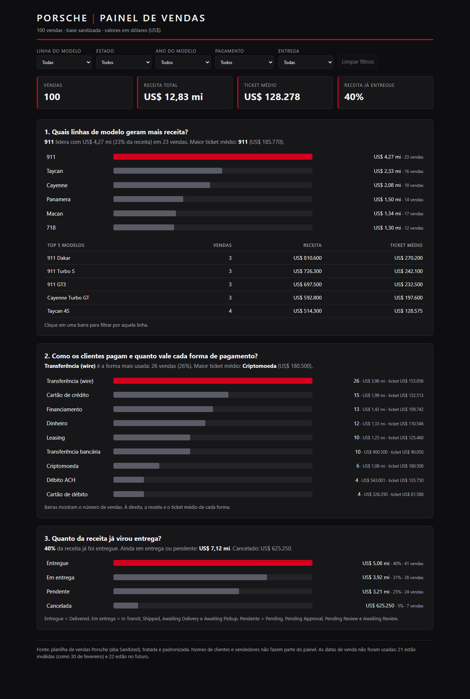
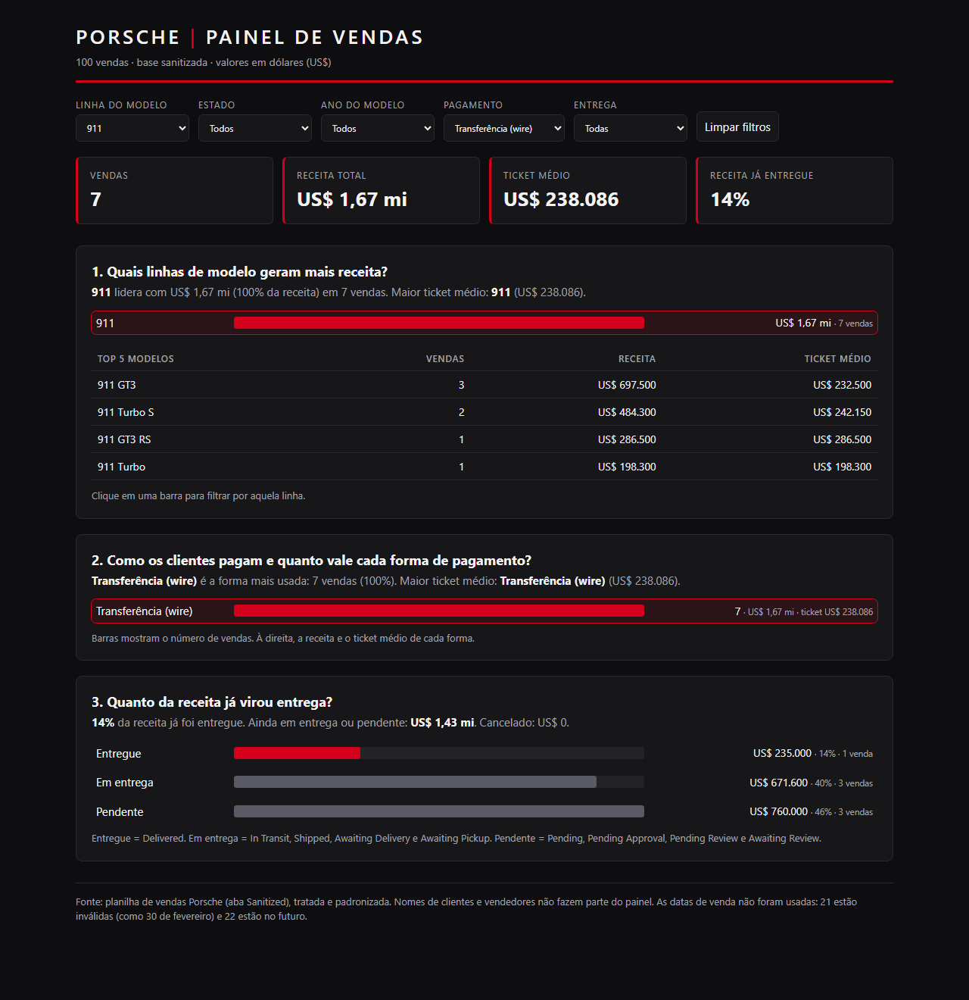
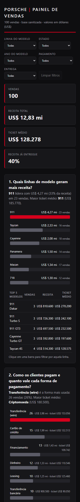

# Painel de Vendas Porsche

Dashboard interativa em um único arquivo HTML (`index.html`), feita a partir de uma planilha com 100 vendas de Porsche. Funciona sem servidor, sem internet e sem bibliotecas externas: os dados vão embutidos no próprio arquivo.

**Endereço da dashboard publicada:** https://guilhermewacilikiw-svg.github.io/relatorio-porshe/



## Perguntas de negócio

| # | Pergunta | Por que importa | Onde aparece |
|---|---|---|---|
| 1 | Quais linhas de modelo geram mais receita? | Mostra onde está o dinheiro: a linha 911 responde por 33% da receita (US$ 4,27 mi), mas o ticket médio também diz se vale priorizar poucos carros caros ou muitos mais baratos. | Barras de receita por linha e tabela dos 5 modelos mais vendidos |
| 2 | Como os clientes pagam e quanto vale cada forma de pagamento? | A transferência (wire) é a forma mais usada (26 vendas), mas a criptomoeda tem o maior ticket médio (US$ 180.500). Isso orienta condições comerciais e custos de recebimento. | Barras de vendas por forma, com receita e ticket médio ao lado |
| 3 | Quanto da receita já virou entrega? | Só 40% da receita está entregue. US$ 7,12 mi estão em entrega ou pendentes e US$ 625 mil foram cancelados. É um indicador de risco e de caixa. | Barras de receita por situação de entrega |

Cada pergunta tem uma frase de resposta, escrita pela própria página, que muda junto com os filtros.

Indicadores de topo: vendas, receita total, ticket médio e receita já entregue.

**Filtros:** linha do modelo, estado, ano do modelo, forma de pagamento e situação de entrega. Também dá para filtrar clicando em qualquer barra, e abrir a página já filtrada pela URL, por exemplo:

```
index.html?linha=911&pag=Wire%20Transfer
```



Com esse filtro são 7 vendas, US$ 1,67 mi de receita e ticket médio de US$ 238.086.

## Tratamento da base

A planilha tem cada campo em duas versões, a crua e a sanitizada, e a coluna sanitizada original tinha falhas (21 datas marcadas `INVALID`, incluindo 3 que eram recuperáveis). Por isso a limpeza foi refeita a partir das colunas cruas, com regras explícitas, e comparada com a coluna original.

- **Preço**: de formatos como `$121k`, `$89.750,00`, `USD 112.750` e `eighty two thousand USD` para número em dólares.
- **Ano do modelo**: de `twenty twenty four`, `20-23` e `20 24` para o ano com 4 dígitos.
- **Quilometragem**: tudo em milhas (4 valores em km foram convertidos); `new` e `zero miles` viraram 0.
- **Pagamento, estado e situação de entrega**: padronizados (`DELIVERD` e `delivered!!!` viram `Delivered`; nomes de estado viram sigla).
- **Datas**: 21 são impossíveis (como 30 de fevereiro) e 22 estão no futuro. Por isso **a dashboard não usa datas**, e não há gráfico de evolução no tempo.

Para o painel ficaram só as colunas necessárias: modelo, ano, preço, quilometragem, pagamento, estado e situação de entrega. **Nomes de clientes e de vendedores não entram no HTML**, já que a base vai embutida e é pública.

## Como foi feito

**Ferramenta:** agente de código (Claude Code), sem ChatGPT Canvas e sem skill específica de dashboard. O fluxo foi o mesmo do desafio, só que o agente escreveu o código, abriu a página em um navegador, aplicou filtros e conferiu os números contra o pandas.

**Pedido inicial:**

> Resolva este exercício com a base limpa: dashboard em HTML de arquivo único, com três perguntas de negócio, filtros, indicadores de topo e visual coerente.

**O que mudou até a versão final:**

1. As datas e os nomes saíram da base embutida (datas inválidas e dado pessoal).
2. Foi acrescentado o filtro "Entrega", para a pergunta 3 poder ser recortada.
3. Cada gráfico ganhou uma frase de resposta que se atualiza com os filtros.
4. A coluna de valores à direita estava estreita e quebrava em duas linhas, então foi alargada.
5. No celular as barras ficavam minúsculas. O layout móvel passou a pôr rótulo e valor na mesma linha, com a barra embaixo.
6. Filtros pela URL, para compartilhar um recorte.
7. Correção de texto: "1 venda" no singular.

## Visual

Tema escuro com vermelho como destaque (referência à identidade da marca), títulos em caixa alta com espaçamento largo e fonte do sistema (Segoe UI, Helvetica, Arial). A barra vermelha é sempre a maior do grupo, e a barra selecionada fica destacada.



## Arquivos

| Arquivo | Descrição |
|---|---|
| `index.html` | A dashboard (arquivo único, dados embutidos) |
| `images/` | Prints da dashboard |

## Como publicar

Suba `index.html` e a pasta `images/` para um repositório público e ligue o GitHub Pages em Settings, Pages, branch `main`, pasta raiz.

## Observações

- Os valores são em dólares (US$), como na base.
- A base parece sintética. As conclusões descrevem os números do arquivo.
